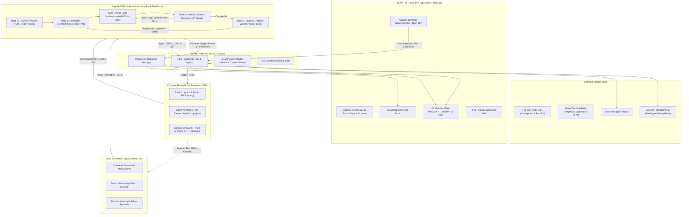

# PhotoCAD - System Architecture & Technical Specification

## 1. Architectural Overview

PhotoCAD implements a **Decoupled Thin-Client + Serverless Cloud GPU + Stateful Agentic Control Plane** architecture designed to transform 4-to-6-sided physical object photographs into editable, millimeter-accurate **Boundary Representation (B-Rep) CAD solids** (`.STEP`, `.DXF`, `.STL`, `.py`).

---

## 2. End-to-End Pipeline Stages

### Stage 1: Real-Time Handheld Web Capture & Metric Calibration
1. **Camera Feed:** Captures high-resolution video via `navigator.mediaDevices.getUserMedia` with continuous video mounting and passive permission checks.
2. **Real-Time Blur Rejection:** Client-side discrete Laplacian variance filter evaluates frame sharpness at 60 FPS. Only frames meeting $\sigma^2 \ge 120.0$ are accepted for automatic capture or manual snap.
3. **6-Axis Sequence:** Step-by-step guidance across `FRONT (+Y)`, `BACK (-Y)`, `LEFT (-X)`, `RIGHT (+X)`, `TOP (+Z)`, and optional `BOTTOM (-Z)` elevations.
4. **Metric Calibration ($1:1\text{ mm}$):**
   * Two-point interactive caliper measuring tool allows the user to pin two points on the primary elevation and enter known caliper-measured millimeters.
   * Derives exact `scale_px_to_mm` factor used to scale point clouds and CSG primitives before CAD synthesis.

### Stage 2: 3D Surface Reconstruction (Cloud GPU & Zero-Heat Visual Hull)
* **Mode A: Cloud GPU Fusion (`gpu_workers/modal_app.py` on Modal NVIDIA L4):**
  1. **SAM 2.1 Hand & Background Stripping:** Identifies human fingers/palms touching the frame edges using YCrCb skin-chrominance clustering and removes studio backdrops.
  2. **Depth Anything 3 / V2:** Predicts mutually consistent dense depth maps across the 6 views and unprojects foreground pixels into camera-space 3D point clouds.
  3. **Open3D Registration:** Eliminates statistical outliers, aligns views in $SO(3)$, performs FPFH + RANSAC coarse alignment followed by multi-scale Point-to-Plane ICP, scales geometry $1:1\text{ mm}$, and extracts bounding boxes, symmetry planes, planar faces, and cylindrical holes into `Open3DGeometryReport`.
* **Mode B: Zero-Heat Volumetric Visual Hull Carving (`app/cad/visual_hull.py`):**
  * Operates completely offline without cloud GPU dependency.
  * Employs GrabCut foreground segmentation, circular Euler hole detection, aspect ratio orientation alignment, 6-axis voxel carving, Taubin surface smoothing, and manifold pinch cleanup.

### Stage 3: 5-Node Cyclic LangGraph Dual-Loop CAD Synthesis
PhotoCAD uses a stateful **5-Node Cyclic LangGraph State Machine** featuring two nested self-correcting feedback loops:
1. **Node 1: Geometry Analyst (`geometry_analyst`)**
   * Reconciles 6 masked perspective thumbnails with the Open3D metric inventory and carved visual hull metadata.
   * Classifies object taxonomy (e.g., prismatic mounting block, flanged housing, sculpted solid) and identifies functional bores and datum faces.
2. **Node 2: Parametric Architect (`parametric_architect`)**
   * Generates a declarative `CSGFeatureTree` ADT with strict topological ordering: base extrusion $\to$ planar cuts $\to$ cylindrical holes $\to$ fillets & chamfers ordered strictly last to prevent OpenCascade geometry invalidation.
   * Parses conversational `/refine` user instructions into targeted feature mutations.
3. **Node 3: CAD Code Synthesizer (`cad_synthesizer`)**
   * Generates deterministic Python code utilizing the **`build123d`** B-Rep context-manager API (`with BuildPart() as part:`).
   * Injects curated `build123d` code patterns via `Build123dRAGService`.
   * Emits live unified code diffs streamed over WebSockets to the frontend.
4. **Node 4: Isolated AST Sandbox Executor (`sandbox_executor` - *Inner Loop*)**
   * Inspects code via `ast.parse()` static analysis: forbids dangerous builtins (`eval`, `exec`, `open`, `__import__`), forbids OS/network calls, and verifies `RESULT_PART = part.part`.
   * Executes code in an isolated sub-process or Modal gVisor container (`network=None`, 30s timeout).
   * **Inner Loop:** If OpenCascade kernel or syntax exceptions occur, intercepts traceback and routes back to Node 3 for up to 3 automatic self-healing patches.
5. **Node 5: Geometric Accuracy Validator (`geometric_validator` - *Outer Loop*)**
   * Evaluates 2-manifold watertight topology (every edge shared by exactly 2 opposing faces) and computes volume ($\text{mm}^3$) via the Divergence Theorem.
   * Samples 20,000 area-weighted surface points from the compiled `.STL` and measures bidirectional Chamfer Distance against the fused `.PLY` scan.
   * **Outer Loop:** If Chamfer distance exceeds $1.0\text{ mm}$, formulates discrepancy notes and loops back to Node 2 for up to 3 geometric adjustment iterations.
   * **Best-Effort Retention Guard:** Guarantees that the lowest-error watertight revision is always preserved and exported, even if subsequent iterations diverge.

### Stage 4: AutoCAD, Fusion 360 & SolidWorks Interoperability Exporters
* **ISO 10303-21 STEP AP214 (`app/cad/exporter.py`):** Emits referentially-complete STEP files with valid `CLOSED_SHELL` $\to$ `MANIFOLD_SOLID_BREP` topology, `SI_UNIT(.MILLI.,.METRE.)` units, and zero dangling entity IDs.
* **AutoCAD DXF R12/2010:** Generates 2D orthographic projection blueprints with `$INSUNITS = 4` ($mm$) and dedicated `GEOMETRY` and `ANNOTATIONS` layers.
* **Watertight STL:** Produces clean ASCII/binary meshes for 3D printing slicing.
* **Golden Dataset Automated Verifier (`app/cad/interop_verifier.py`):** Verified against 10 canonical industrial archetypes.

### Stage 5: Web Thin-Client 3D Studio & Conversational `/refine`
* **Three.js / React Three Fiber Viewport:** Solid shaded, wireframe overlay, X-ray transparency, turntable simulation, and 3D point-to-point tape measure (`mm`/`inch`).
* **Conversational `/refine` Studio:** Users modify dimensions or add features via natural language (e.g., *"Change bore diameter to 12mm and add 1.5mm chamfer"*); re-enters the LangGraph state machine directly at Node 2 for fast sub-15-second turnaround without re-scanning.

---

## 3. Database Schema (Async SQLAlchemy 2.0)

* **`projects`**: Top-level engineering workspace (`id`, `name`, `description`, `created_at`).
* **`scan_sessions`**: Multi-view capture records (`id`, `project_id`, `status`, `has_scale_reference`, `scale_px_to_mm`, `views_data` JSON, `geometry_report_json` JSON, `ply_file`).
* **`cad_generations`**: Versioned CAD synthesis history (`id`, `scan_session_id`, `version`, `status`, `code`, `step_file`, `stl_file`, `dxf_file`, `dimensions_mm` JSON, `created_at`).
* **`agent_logs`**: Traceable multi-agent execution audit trail (`id`, `generation_id`, `agent_role`, `message`, `message_type`, `payload` JSON, `created_at`).

---

## 4. Multi-Tier Cloud Deployment Topology

| Tier | Provider | Role | Fallback / Local Mode |
| :--- | :--- | :--- | :--- |
| **Thin-Client Frontend** | Vercel / Cloudflare Pages | React 19 SPA build, global CDN | Local Vite dev server (`http://localhost:5173`) |
| **Control Plane API** | Railway / Render / Fly.io | FastAPI Async REST + WebSockets | Local Uvicorn server (`http://localhost:8000`) |
| **Serverless Cloud GPU** | Modal (NVIDIA L4) | SAM 2.1, Depth Anything 3, Open3D | Zero-Heat Volumetric Visual Hull Carving |
| **Hot State & Checkpoints** | Redis Cloud 8.0+ / Upstash | WebSockets Pub/Sub & LangGraph threads | In-memory `MemorySaver` checkpointer |
| **Warm Relational & RAG** | Supabase (PostgreSQL 16) | Project persistence & `pgvector` HNSW | Local SQLite (`sqlite+aiosqlite`) |
| **Cold Object Storage** | Cloudflare R2 | Pre-Signed SigV4 raw PNGs & CAD exports | Local filesystem mounts (`/storage/`) |
