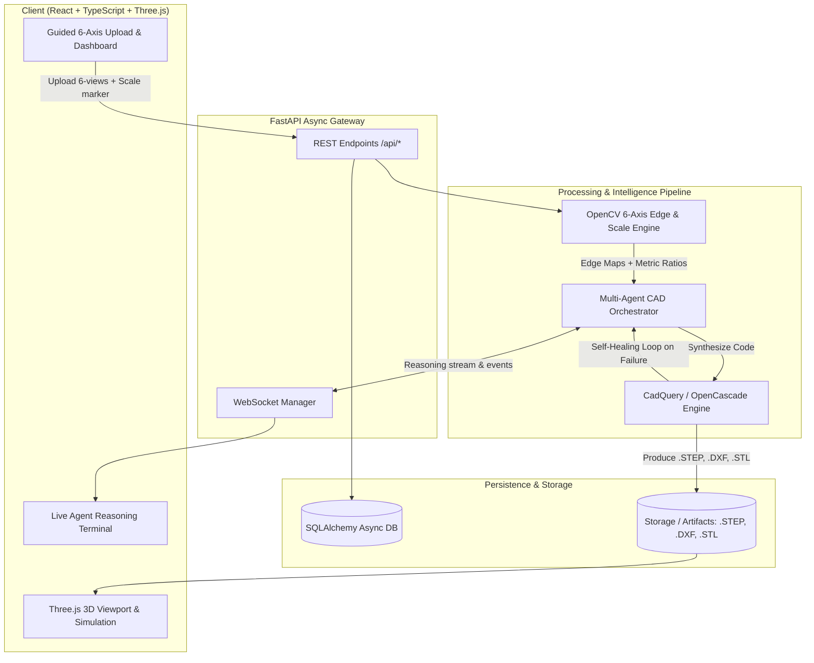

# PhotoCAD - System Architecture & Technical Specification

## 1. Architectural Overview

PhotoCAD operates on an asynchronous event-driven architecture designed to transform multi-view 2D raster imagery into parametric B-Rep CAD solids.



---

## 2. Data Flow & Execution Stages

### Stage 1: Orthographic 6-Axis Image Ingestion & Edge Extraction
1. User provides 6 orthogonal captures:
   * **Front ($+Y$)**, **Back ($-Y$)**, **Left ($-X$)**, **Right ($+X$)**, **Top ($+Z$)**, **Bottom ($-Z$)**.
2. **Metric Calibration:**
   * An optional 2cm ArUco marker or circular reference object is detected in the primary view.
   * Pixel-to-millimeter ratio is computed: $\text{scale} = \frac{\text{known\_size\_mm}}{\text{detected\_pixel\_width}}$.
3. **OpenCV Edge & Silhouette Decomposition:**
   * Adaptive bilateral filtering reduces surface texture noise while preserving geometric boundaries.
   * Canny edge operator + Otsu thresholding generates crisp binary contours.
   * Ramer-Douglas-Peucker contour approximation extracts simplified vector vertex coordinates.

### Stage 2: Multi-Agent AI Decomposition
Instead of relying on a single generative prompt, 4 distinct agent roles collaborate:

1. **Spatial Vision Analyst:**
   * Reads the 6 image views alongside their corresponding vector contours and detected dimensions.
   * Identifies overall bounding volume ($X \times Y \times Z\text{ mm}$), primary symmetry planes, and feature locations (counterbores, slots, bosses).
2. **CSG Geometric Architect:**
   * Formulates an explicit Constructive Solid Geometry sequence using primitives (Workplane, Box, Cylinder, Polygon) and boolean operations (Cut, Union, Intersect, Fillet).
3. **CadQuery Code Synthesizer:**
   * Outputs deterministic, standard Python code utilizing `cadquery` primitives.
   * Example:
     ```python
     import cadquery as cq
     result = (
         cq.Workplane("XY")
         .box(80.0, 50.0, 20.0)
         .faces(">Z")
         .workplane()
         .hole(12.0)
         .edges("|Z")
         .fillet(3.0)
     )
     ```
4. **Self-Healing Compiler & Validator:**
   * Executes the generated CadQuery script inside a sandboxed sub-process.
   * If a geometric kernel error occurs (e.g. `Standard_ConstructionError: Fillet radius too large`), the compiler intercepts the traceback, packages the error context, and queries the code synthesizer agent for an immediate patch.
   * Supports up to 3 automatic healing iterations.

### Stage 3: CAD Export & Verification
* The OpenCascade engine evaluates the valid B-Rep model and exports:
  1. `model.step` (AP214 / AP242 standard format for AutoCAD, SolidWorks, FreeCAD).
  2. `model.dxf` (2D orthogonal projected technical drawing).
  3. `model.stl` (Tessellated triangulated mesh with controlled chordal deviation).

### Stage 4: 3D Visualization & Simulation
* The frontend loads the `.stl` mesh via `@react-three/fiber`.
* Renders shaded mesh, customizable wireframe overlay, and dynamic coordinate gizmo.
* Includes turntable rotation simulation to verify symmetry and physical proportions.

---

## 3. Database Schema Design (SQLAlchemy)

* **`projects`**: Top-level workspace for a reverse-engineering job.
  * `id` (UUID), `name`, `description`, `unit` (mm/inch), `created_at`, `updated_at`.
* **`scan_sessions`**: The multi-angle visual captures.
  * `id`, `project_id`, `has_scale_reference`, `scale_ratio_px_to_mm`, `views_data` (JSON of paths & contours).
* **`cad_generations`**: Versioned history of CAD synthesis.
  * `id`, `scan_session_id`, `version_number`, `cadquery_code`, `status` (pending, compiled, failed), `step_path`, `dxf_path`, `stl_path`, `error_log`.
* **`agent_logs`**: Traceability of multi-agent decisions.
  * `id`, `generation_id`, `agent_role`, `message`, `timestamp`.
